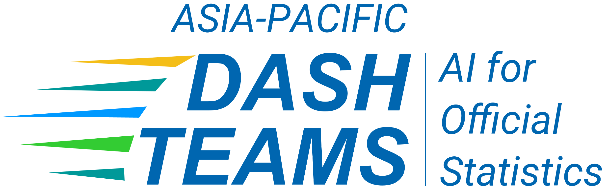

::: {.home-logos-split}

::: {.home-logos-left}
{.home-logo .escap}
:::

::: {.home-logos-right}
{.home-logo .dash}
:::

:::

# AI for Official Statistics: Case Study Repository

This repository is being developed by the **DASH Team on Artificial Intelligence for Official Statistics**, established by ESCAP to document and share regional experiences of AI use in official statistics across Asia and the Pacific.

Its purpose is to support **learning, peer exchange, and collaboration** by bringing together practical examples of AI initiatives in National Statistical Offices (NSOs) — including pilot projects, research activities, operational applications, and exploratory work carried out within an NSO or with partner institutions.

To learn more about the DASH Team’s work, please see the **[About](about.qmd)** page.

[Browse case studies](case-studies.qmd){.btn .btn-primary}  
[Submit a case study](submit.qmd){.btn .btn-outline-primary}

Case studies are published only where permission is provided.

**Template:**  
- [Download a copy of the case study template (PDF)](assets/ai-dash-case-study-template.pdf)